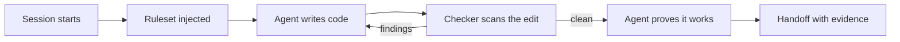
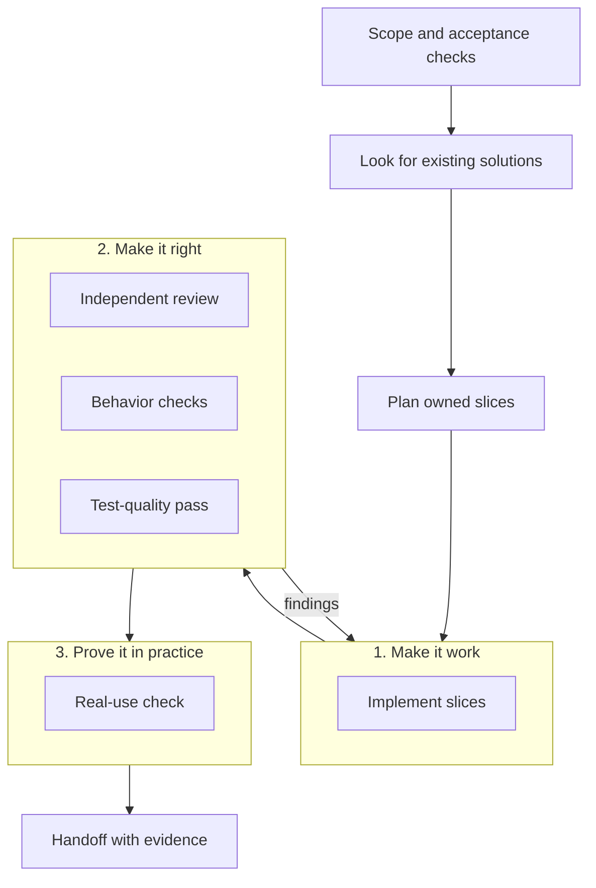
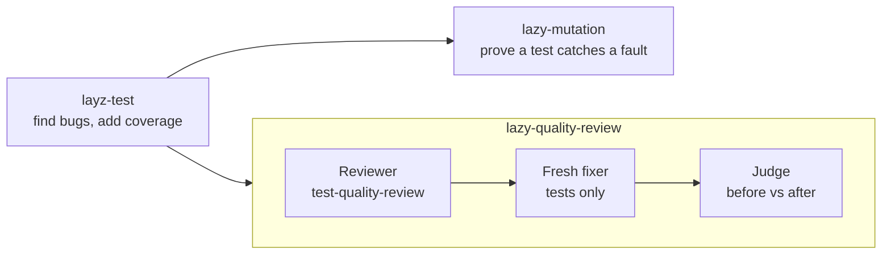
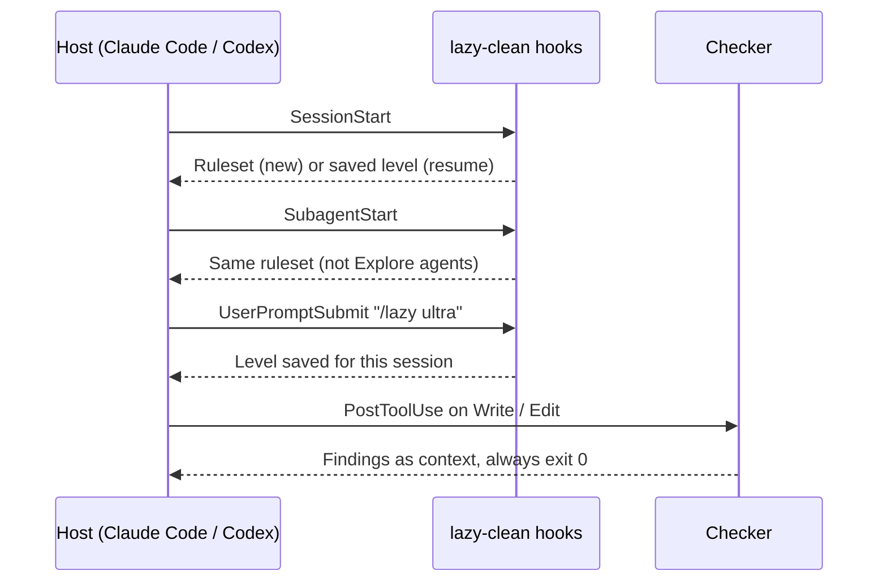

# lazy-clean

Skills and hooks that keep coding agents small and honest: write the least code
that works, check it, and prove it before handing it back.

It works with Claude Code, Codex, OpenCode, Cursor, Copilot, and any agent that
reads `AGENTS.md` or a skills folder. It needs only `node` 18+. No dependencies.

## What it does

1. **While writing:** a short ruleset tells the agent to reuse what exists,
   skip unasked features, and keep tests honest. A bug that breaks the request,
   repeats at a sibling site, or sits in an edited function gets fixed at its
   cause. Other bugs get reported with a failing input and left alone.
2. **After every edit:** a checker scans changed TypeScript and JavaScript for
   slop (filler code, pointless comments, needless copies) and hands the
   findings back to the agent. It never blocks.
3. **On request:** skills for guided builds, testing, mutation checks, and
   test-quality review.



## Install

Skills only, for any agent that reads a skills folder:

```sh
gh skill install JustasMonkev/lazy-clean --all --agent claude-code --scope user
```

Use `--agent codex` for Codex. Drop `--scope user` for a project-only install.

Full plugin with hooks, for Claude Code:

```sh
claude --plugin-dir /path/to/lazy-clean
# or
claude plugin marketplace add /path/to/lazy-clean
```

Skills-only mode gives you every skill on demand. Only the plugin runs the
ruleset and the checker automatically.

Update a skills-only install:

```sh
gh skill update --dir ~/.claude/skills \
  layz-test lazy lazy-audit lazy-clean lazy-debt lazy-gain lazy-help \
  lazy-review lazy-quality-review lazy-mutation lazy-verify slop-check test-quality-review
```

Add `--dry-run` to preview. Other folders: `~/.agents/skills` (Codex, user),
`.claude/skills` (Claude Code, project), `.agents/skills` (Codex, project).
Without GitHub CLI, copy by hand: `cp -R /path/to/lazy-clean/skills/* ~/.claude/skills/`.
Hand copies cannot use `gh skill update`.

## Supported agents

| Level | Agents | What you get |
| --- | --- | --- |
| Full hooks | Claude Code, Codex | Ruleset at session and subagent start, `/lazy` commands, checker after every edit |
| Plugin | OpenCode | Ruleset every turn, slash commands. Needs `.opencode/`, `opencode.json`, `hooks/`, and `skills/` together |
| Rules file | Cursor, Copilot | Always-on ruleset in `.cursor/rules/lazy-clean.mdc` and `.github/copilot-instructions.md` |
| `AGENTS.md` | Codex, Zed, Amp, Jules, others | Ruleset plus the checker step |
| Skills only | Anything that reads `~/.claude/skills` | Every skill on demand, no automation |

Outside the full-hooks level, run the checker yourself after TS/JS changes:

```sh
node ~/.claude/skills/slop-check/scripts/check.mjs --since=HEAD
```

## Skills

| Skill | What it does |
| --- | --- |
| `lazy-clean` | Guided build from scope to verified handoff, using subagents |
| `lazy` | The core ruleset: least code that works, reuse first |
| `slop-check` | Scan TS/JS for slop and explain each finding |
| `lazy-review` | Review a diff for over-engineering only |
| `lazy-audit` | Whole-repo report of what to delete or simplify |
| `layz-test` | Find and reproduce bugs, add coverage, list manual checks |
| `lazy-mutation` | Break the code on purpose to prove a test catches it |
| `test-quality-review` | Find tests that pass even when the code is broken |
| `lazy-quality-review` | Review, fix, and judge tests in three separate agents |
| `lazy-verify` | Experimental. Fix/preserve evidence from a local engine |
| `lazy-debt` | List every deliberate shortcut marked `lazy:` |
| `lazy-help` | Quick card of modes and commands |
| `lazy-gain` | Show recorded benchmark results |

How to call a skill:

| Host | Example |
| --- | --- |
| Claude Code plugin | `/lazy-clean:lazy-clean <task>` |
| Claude Code skills-only, OpenCode | `/lazy-clean <task>` |
| Codex | `$lazy-clean <task>`, or pick it in the skill picker |

## The guided build: `lazy-clean`

One coordinator plans the work and hands slices to subagents. Each phase must
pass before the next starts.



Rules it keeps:

- Small tasks use fewer agents.
- Missing access, hardware, or credentials mark a step **blocked**, never passed.
- Commits, pushes, and deploys are never automatic. Allowed PRs are draft-only.
- A passed check proves its own assertions, not general correctness.

## Test skills

Four skills, each with one job:



- The reviewer only reports. A separate fresh agent makes the fixes.
- The fixer changes tests only. Product bugs get reported with a failing test.
- Every deleted test is explained.

## Languages

The rules cover TypeScript, JavaScript, Java, Python, Ruby, Rust, and Go. The
agent reads the installed version from your toolchain file, manifest, or
lockfile, and keeps advice valid for it. If it cannot check a version fact, it
says so instead of guessing.

The checker reads source text, so it works on every TypeScript version,
including 7. It scans TS/JS only. The other five languages get the written
checklists. Extra references: [TS/JS checks](skills/lazy/references/simplification-checks.md),
[Python checks](skills/lazy/references/python-checks.md),
[design checks](skills/lazy/references/design-checks.md).

## The checker

```sh
node skills/slop-check/scripts/check.mjs [paths...] [--since=<ref>] [--summary] [--json] [--explain=<rule-id>] [--disable=<rule-id>,...]
```

| Exit | Meaning |
| --- | --- |
| 0 | Clean, or zero files checked (the summary then says `no coverage`) |
| 1 | Findings |
| 2 | A path could not be read |

`--since=<ref>` reports only lines added since that ref. Git is the baseline,
so there is no baseline file to keep up to date.

```sh
node skills/slop-check/scripts/check.mjs --since=HEAD          # before a commit
node skills/slop-check/scripts/check.mjs --since=origin/main   # in CI
node skills/slop-check/scripts/check.mjs --explain=no-json-clone
```

Findings are advice. Mechanical ones have one right fix. Review ones may be
deliberate, and "leaving it, here is why" is a valid answer. Do not add
suppression comments to make a scan clean. Old `slop-check-ignore` directives
still work but count as suppressions in the summary.

## When the hooks run



- Only `.ts .tsx .mts .cts .js .jsx .mjs .cjs` are checked.
- Edits made through `Bash` (heredocs, `sed -i`) are not seen. Run the checker
  yourself, or run `--since=HEAD` before finishing.
- The ruleset adds about 2,000 tokens to each subagent request.

## Settings

| What | How |
| --- | --- |
| Change level | `/lazy lite`, `/lazy full` (default), `/lazy ultra`, `/lazy off` |
| Show level | `/lazy` |
| Default for new sessions | `/lazy default <lite\|full\|ultra\|off>` |
| Pick which subagents get the ruleset | `LAZY_SUBAGENT_MATCHER=<regex>` (`.` includes Explore) |
| Hide the status badge | `LAZY_HIDE_STATUS=1`, or `"hideStatus": true` in `~/.config/lazy/config.json` |
| Turn off the checker | Remove the `PostToolUse` entry from `hooks/lazy-clean.json` |
| Turn off everything | Disable the plugin in `/plugin` |

Each session keeps its own level across resume and compaction when the host
gives a session ID. The status badge script is `hooks/lazy-statusline.sh`
(`.ps1` on Windows). The plugin offers to add it once.

## Benchmarks

All results below are recorded in this repo with raw data. Read the linked file
before quoting a number. Small task sets cannot prove broad quality gains, and
none of these claim to.

### Token cost on Claude Opus 5.5 and Sonnet 5.5

14 tasks, real plugin install, 3 trials per arm, 252 runs. Every run passed its
hidden check, with or without the plugin.

| Model | Arm | Pass | Mean tokens | Mean turns | Mean cost USD |
| --- | --- | --: | --: | --: | --: |
| Opus 5.5 | no plugin | 42/42 | 55,415 | 6.1 | 0.098 |
| Opus 5.5 | plugin | 42/42 | 100,901 | 8.5 | 0.161 |
| Sonnet 5.5 | no plugin | 42/42 | 60,387 | 6.0 | 0.051 |
| Sonnet 5.5 | plugin | 42/42 | 82,058 | 6.7 | 0.071 |

The plugin costs more tokens. Most of it buys evidence: a failing test before
the fix, the checker run, and mutation checks. These tasks are easy enough to
pass without the plugin, so this run cannot show a quality gain or loss.
[Full report](benchmarks/results/plugin-tokens-20261007/README.md).

### Skill on vs off, three models

Two real Appium bug fixes, three models, 3 repeats each, 36 runs. Blind
10-point scores, medians.

| Model | Task | Off | On | Strict gates (off to on) |
| --- | --- | --: | --: | --- |
| Luna | URL | 9.50 | 9.80 | 3/3 to 3/3 |
| Luna | CLI | 9.75 | 9.65 | 3/3 to 3/3 |
| Sol | URL | 10.00 | 10.00 | 3/3 to 3/3 |
| Sol | CLI | 9.80 | 9.80 | 3/3 to 3/3 |
| GLM | URL | 9.90 | 9.70 | 3/3 to 3/3 |
| GLM | CLI | 9.60 | 9.50 | 2/3 to 3/3 |

All 18 skill-on runs passed every strict gate. 17 of 18 controls did. Score
changes are small and go both ways. [Full report](benchmarks/paired-models.md).

### Other recorded runs

| Study | Result | Report |
| --- | --- | --- |
| SOLID guidance pilot (Luna, 54 task runs) | Revised rules passed 18/18 hidden checks vs 17/18. No arm saved regression tests. | [solid-guidance.md](benchmarks/solid-guidance.md) |
| Real PR regressions (Luna, 4 cases) | Both arms passed all 4. Manual review found one case where the rules-on run missed reusing an existing method. | [luna-pr-regressions.md](benchmarks/luna-pr-regressions.md) |
| All-skill token cut (Sol and Luna) | Goal was 20% fewer tokens. Not reached: final candidate used 1.30% more. | [skill-tokens](benchmarks/results/skill-tokens-20261006/README.md) |
| Skill retention and Appium smoke | Lifecycle and state fixes, with red-green logs. | [skill-reliability.md](benchmarks/skill-reliability.md) |

### Run them yourself

```sh
node benchmarks/run.mjs /tmp/lazy-eval-config.json /tmp/lazy-eval-results
```

The default run is 84 agent calls (14 tasks, 3 trials, rules off and on). Set
`"taskSet"` in the config to pick another set:

| `taskSet` | What it checks |
| --- | --- |
| `core` (default) | 14 tasks: explicit values, user edits, trust boundaries, cleanup |
| `solid` | 6 tasks: module boundaries and contracts |
| `implementation` | 5 tasks: reuse of native APIs and existing code |
| `hidden` | 12 tasks: is a bug the prompt never names fixed or reported |

Setup and how to read results: [benchmarks/README.md](benchmarks/README.md).

## Develop

```sh
npm test              # rules, CLI, hooks, benchmark machinery. No AI calls.
npm run slop-check    # the checker on this repo
```

This is a renamed hard fork of two upstream projects. To compare or port
upstream changes, follow the [update procedure](skills/lazy-clean/references/upstream-updates.md)
and record it in [UPSTREAM.md](UPSTREAM.md).

## License

MIT
